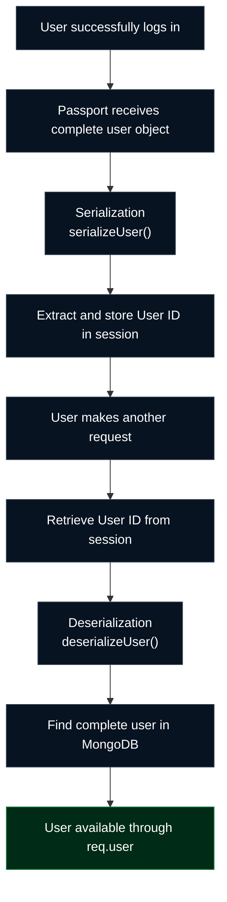
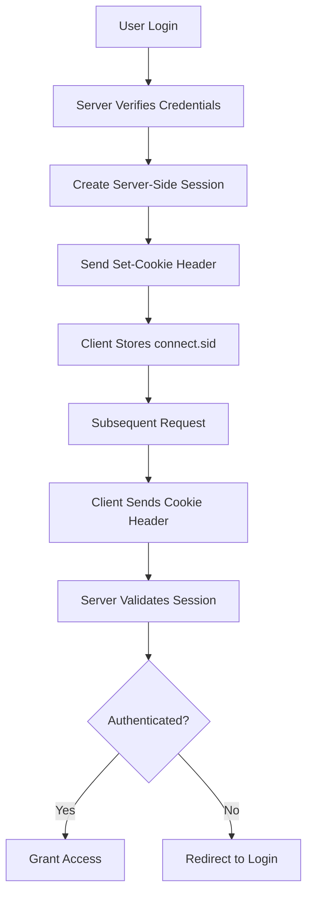

# Day 03 – Authentication, Cookies & Request Body

## Overview

Day 03 focuses on understanding authentication mechanisms, cookies, sessions, and request bodies in Postman.

For practical implementation, I used my existing **Wanderlust (Airbnb Clone)** project, built with Node.js, Express.js, MongoDB, Passport.js, and express-session.

## Topics Covered

- Authentication vs Authorization
- HTTP Authentication Flow
- Authentication Types in Postman
- Cookies and Sessions
- Session-based Authentication
- Request Body and its types
- Content-Type Header
- Testing protected routes using Postman

---

## 1. Authentication vs Authorization

### Authentication

Authentication verifies the identity of a user.

It answers:

**Who are you?**

Example: A user logs into Wanderlust using their username and password.

### Authorization

Authorization determines what an authenticated user is allowed to access or perform.

It answers:

**What are you allowed to do?**

Example: A user can edit or delete only their own listings, not listings created by other users.

| Authentication | Authorization |
|---|---|
| Verifies user identity | Checks user permissions |
| Happens before authorization | Follows authentication |
| Example: Login | Example: Edit own listing |

In Wanderlust:
- `isLoggedIn` checks whether the user is authenticated.
- `isOwner` checks whether the authenticated user owns a listing.
- `isReviewAuthor` checks whether the user is the author of a review.

---

## 2. HTTP Authentication Flow

A typical authentication process works as follows:

1. The client sends login credentials to the server.
2. The server verifies the credentials.
3. The server establishes an authenticated session or issues a token.
4. The client stores the session cookie or token.
5. The client sends the stored credentials with subsequent requests.
6. The server verifies the session or token before granting access.

### Authentication Flow Diagram


### 3. Complete Session-Based Authentication Process

Let's trace the complete journey of session-based authentication in Wanderlust.

```mermaid
flowchart TD
    A["<b>Step 1 — User logs in</b><br/><br/>Postman / Browser<br/>POST /login<br/>Username + Password"]

    B["<b>Step 2 — Server verifies credentials</b><br/><br/>Passport Local Strategy checks the submitted credentials against the user stored in MongoDB.<br/><br/><b>MongoDB</b><br/>Finds and verifies user"]

    C["<b>Step 3 — Express creates a session</b><br/><br/>express-session creates a session and stores it in MemoryStore.<br/><br/>Passport serializes the user's ID into the session.<br/><br/><b>Express MemoryStore</b><br/>Session ID → Session Data → User ID"]

    D["<b>Step 4 — Server sends a cookie</b><br/><br/>Set-Cookie: connect.sid=...<br/><br/>Postman receives and stores this cookie."]

    E["<b>Step 5 — User makes another request</b><br/><br/>GET /listings/new<br/>Cookie: connect.sid=..."]

    F["<b>Step 6 — Express retrieves the session</b><br/><br/>express-session reads the cookie, identifies the session and retrieves the corresponding session data from MemoryStore."]

    G["<b>Step 7 — Passport restores the user</b><br/><br/>Passport uses the serialized user ID and calls deserializeUser() to restore the user from MongoDB.<br/><br/>The user becomes available through req.user."]

    H["<b>✓ User authenticated!</b>"]

    A --> B --> C --> D --> E --> F --> G --> H

    classDef normal fill:#081321,stroke:#263445,color:#ffffff,stroke-width:1px
    classDef success fill:#002b16,stroke:#087b3b,color:#ffffff,stroke-width:1px

    class A,B,C,D,E,F,G normal
    class H success

    linkStyle default stroke:#9ca3af,stroke-width:1.5px
```




*Note: The diagram illustrates session-based authentication. Token-based authentication follows a different credential-handling mechanism.*

---

## Why Do We Need Serialization and Deserialization?

In Passport.js, serialization and deserialization help maintain a user's authenticated state across multiple HTTP requests.

Let's understand why both are required.

### 1. Serialization – Storing the User ID

When a user logs in successfully, Passport receives the complete user object from the Local Strategy.

For example:

```javascript
{
    _id: "12345",
    username: "Mayuri",
    email: "mayuri@example.com"
}
```

Instead of storing the entire user object in the session, Passport stores only the user's unique ID.

This process is called **Serialization**.

```javascript
passport.serializeUser((user, done) => {
    done(null, user._id);
});
```

**In simple words:** Serialization decides what user information should be stored in the session. In our case, it stores only the user ID.

### 2. Deserialization – Retrieving the User

When the same user makes another request, Passport gets the stored user ID from the session.

However, our application often needs the complete user object to perform operations.

Therefore, Passport uses the stored ID to retrieve the user from MongoDB.

This process is called **Deserialization**.

```javascript
passport.deserializeUser(async (id, done) => {
    try {
        const user = await User.findById(id);
        done(null, user);
    } catch (err) {
        done(err);
    }
});
```

After successful deserialization, Passport makes the user available through:

```javascript
req.user
```

**In simple words:** Deserialization uses the stored user ID to retrieve the complete user information from MongoDB.

### 3. Why Do We Need Both?

Consider our Wanderlust application.

After login, the session contains the user's ID, not the complete user document.

But our application needs the actual user information for operations such as:

- Identifying the logged-in user.
- Associating a newly created listing with its owner.
- Checking whether a user owns a particular listing.
- Checking whether a user is the author of a review.

For example:

```javascript
newListing.owner = req.user._id;
```

Here, `req.user` contains the restored user object.

Therefore:

- **Serialization:** Stores the user's ID in the session.
- **Deserialization:** Retrieves the complete user object using that ID.

### 4. Serialization and Deserialization Flow



### 5. Quick Comparison

| Serialization | Deserialization |
|---|---|
| Happens during login | Happens during subsequent authenticated requests |
| Receives the user object | Receives the stored user ID |
| Stores the user ID in the session | Retrieves the complete user from MongoDB |
| Uses `serializeUser()` | Uses `deserializeUser()` |

### Key Takeaway

Serialization stores the user's ID in the session, while deserialization retrieves the complete user object using that ID.

Together, they allow Passport.js to maintain the user's authenticated state across multiple HTTP requests without storing the entire user object in the session.

## 3. Authentication Types in Postman

Postman provides different authentication configurations through the Authorization tab.

### 3.1 No Auth

No authentication credentials are configured through the Authorization tab.

It does not guarantee that an endpoint is public. Cookies or other manually configured headers may still be sent.

### 3.2 Basic Auth

Basic Authentication sends a username and password encoded using Base64.

```http
Authorization: Basic <encoded-credentials>
```

Important: Base64 is encoding, not encryption. HTTPS is necessary to protect credentials in transit.

### 3.3 API Key

An API key is a unique value used to identify or authorize an API client.

It can be sent through:
- Request headers
- Query parameters

Example:

```http
X-API-Key: your_api_key
```

Sending API keys through headers is generally preferable because URLs can be exposed in logs and browser history.

### 3.4 Bearer Token

A bearer token is sent through the Authorization header.

```http
Authorization: Bearer <token>
```

A bearer token may be an opaque token or a JWT. Not every bearer token is a JWT.

**Note:** Our Wanderlust application uses session-based authentication, not Basic Auth, API Key, or Bearer Token authentication.

---

## 4. Cookies and Sessions

### 4.1 What are Cookies?

Cookies are small pieces of data stored on the client side by the browser or API client.

The client sends applicable cookies to the server with subsequent requests.

### 4.2 What are Sessions?

Sessions maintain information about a user's interaction with an application on the server side.

A session allows the server to recognize a user across multiple HTTP requests.

### 4.3 Cookies vs Sessions

| Cookies | Sessions |
|---|---|
| Stored on the client side | Session data stored on the server side |
| Sent with applicable HTTP requests | Identified using a session identifier |
| Can store small pieces of data | Can store user-related session information |
| Example: `connect.sid` cookie | Example: Express session |

### 4.4 How Session-Based Authentication Works

In Wanderlust, we use Passport.js with `express-session`.

1. User submits login credentials.
2. Passport verifies the user.
3. Express creates a session.
4. The server sends a session cookie to the client.
5. Postman stores the cookie.
6. Postman sends the cookie with subsequent requests.
7. Express uses the session identifier to retrieve the session and authenticate the user.

### Session Authentication Diagram



### 4.5 What is `connect.sid`?

`connect.sid` is the default session cookie name used by the `express-session` middleware.

It contains the session identifier, not the complete session data.

The server uses this identifier to locate the corresponding session.

### 4.6 Set-Cookie vs Cookie

| Set-Cookie | Cookie |
|---|---|
| Response header | Request header |
| Sent by the server | Sent by the client |
| Instructs the client to store a cookie | Sends stored cookie data to the server |

Example:

**Server Response:**

```http
Set-Cookie: connect.sid=<session-id>; Path=/; HttpOnly
```

**Subsequent Client Request:**

```http
Cookie: connect.sid=<session-id>
```

### 4.7 HttpOnly Cookie

The `HttpOnly` attribute prevents client-side JavaScript from accessing the cookie through APIs such as `document.cookie`.

It helps reduce the risk of cookie theft through certain XSS attacks.

It does not replace HTTPS or other security protections.

---

## 5. Request Body

A request body contains data sent by the client to the server.

It is commonly used when creating or updating resources.

Example: Creating a listing in Wanderlust.

```json
{
  "listing": {
    "title": "Beautiful Beach House",
    "price": 2500,
    "location": "Goa",
    "country": "India"
  }
}
```

The server receives this data through `req.body`, provided the appropriate Express body parser middleware is configured.

### 5.1 req.params vs req.query vs req.body

| Property | Purpose | Example |
|---|---|---|
| `req.params` | Retrieves route parameters | `/listings/123` |
| `req.query` | Retrieves query parameters | `/listings?location=Goa` |
| `req.body` | Retrieves submitted request data | JSON listing data |

### 5.2 Request Body Types in Postman

Postman provides several body formats.

**1. None**

Used when no request body is required. Commonly used with GET requests.

**2. form-data**

Used to send form fields and files together.

Commonly used for file uploads.

**3. x-www-form-urlencoded**

Used to send URL-encoded key-value pairs.

Example:

```text
username=mayuri
password=123456
```

Our Wanderlust login request uses this format.

**4. raw**

Used to send raw request data such as JSON, Text, JavaScript, HTML, and XML.

For JSON APIs, select:

```text
Body → raw → JSON
```

**5. Binary**

Used to send raw file data, such as an image or PDF.

### 5.3 Express Body Parsing Middleware

Express requires appropriate middleware to parse incoming request bodies.

**JSON Parser:**

```javascript
app.use(express.json());
```

Parses incoming JSON payloads.

**URL-Encoded Parser:**

```javascript
app.use(express.urlencoded({ extended: true }));
```

Parses URL-encoded form submissions.

After parsing, the submitted data becomes accessible through:

```javascript
req.body
```

### 5.4 Content-Type Header

The `Content-Type` request header tells the server the format of the request body.

| Content-Type | Purpose |
|---|---|
| `application/json` | JSON data |
| `application/x-www-form-urlencoded` | URL-encoded form data |
| `multipart/form-data` | Form fields and file uploads |
| `text/plain` | Plain text |
| `application/xml` | XML data |

Postman automatically configures the appropriate Content-Type for most selected body formats.

For multipart form-data, allow Postman to generate the boundary automatically.

---

## 6. Practical Implementation – Wanderlust

### Project Details

| Component | Technology |
|---|---|
| Backend | Node.js, Express.js |
| Database | MongoDB |
| Authentication | Passport.js |
| Session Management | express-session |
| API Testing | Postman |

Base URL:

```text
http://localhost:8080
```

### Practical 1: Inspect Session Cookie

After logging into Wanderlust through Postman:

1. Open Cookie Manager.
2. Select the `localhost` domain.
3. Locate the `connect.sid` cookie.
4. Inspect its properties.

Observed:
- Cookie name: `connect.sid`
- Domain: `localhost`
- Path: `/`
- HttpOnly: Enabled

### Practical 2: Test an Unauthenticated Protected Route

To verify session-based authentication:

1. Open Postman's Cookie Manager.
2. Delete the `connect.sid` cookie.
3. Send the following request:

```http
GET http://localhost:8080/listings/new
```

Expected behaviour:

- `isLoggedIn` detects that the user is unauthenticated.
- Express redirects the request to `/login`.
- The original response is `302 Found`.

Postman automatically follows redirects by default. Therefore, the final response may appear as:

```http
200 OK
```

The response preview displays the login page with the flash message:

```text
You must be logged in to create a new listing.
```

**Important Observation:** A final `200 OK` does not necessarily mean the original protected route was accessed successfully. Postman may have followed an earlier redirect.

### Practical 3: Request Body in Wanderlust

Previously tested request formats:

| Operation | Method | Endpoint | Body Format |
|---|---|---|---|
| Login | POST | `/login` | x-www-form-urlencoded |
| Create Listing | POST | `/listings` | raw JSON |
| Update Listing | PUT | `/listings/:id` | Depends on route configuration |

The backend uses `req.body` to access submitted listing information.

Example:

```javascript
const newListing = new Listing(req.body.listing);
```

The listing is then associated with the authenticated user and saved to MongoDB.

---

## 7. Important Learnings

- Authentication verifies identity, while authorization checks permissions.
- Wanderlust uses session-based authentication with Passport.js and express-session.
- Cookies are stored on the client side, while session data is maintained server-side.
- `connect.sid` identifies a session.
- `Set-Cookie` is sent by the server, whereas `Cookie` is sent by the client.
- Postman automatically stores and sends applicable cookies.
- Request body formats determine how data is transmitted.
- Express body-parsing middleware makes request data accessible through `req.body`.
- Postman automatically follows redirects by default, which can affect the final displayed status code.

---

## 8. Day 03 Completion Checklist

- [x] Authentication vs Authorization
- [x] HTTP Authentication Flow
- [x] Basic Auth
- [x] API Key Authentication
- [x] Bearer Token Authentication
- [x] Cookies and Sessions
- [x] Session-based Authentication
- [x] `connect.sid` and HttpOnly
- [x] Set-Cookie vs Cookie
- [x] Request Body Types
- [x] Content-Type Header
- [x] Express Body Parsing Middleware
- [x] Verified Session Cookie in Postman
- [x] Tested Unauthenticated Protected Route
- [x] Completed Revision Quiz

**Day 03 – Completed!**

Next: Day 04 – Collections, Variables & Environments.

---

## Tools Used

- Postman
- Node.js
- Express.js
- MongoDB
- Passport.js
- express-session
- Git and GitHub

**Repository:** postman-learning
